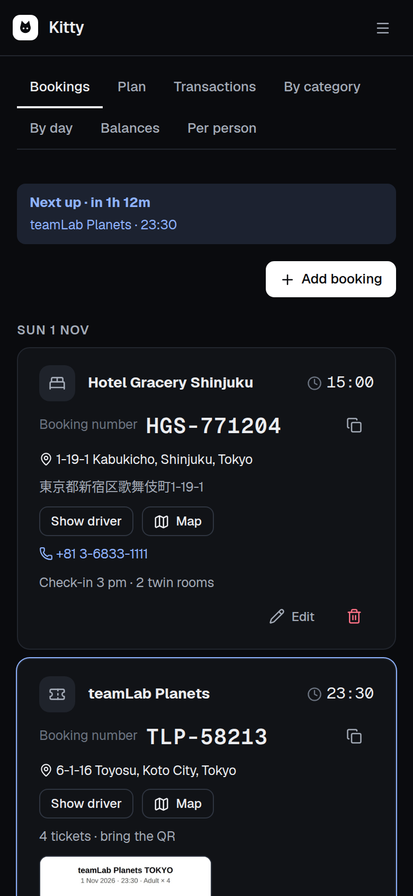
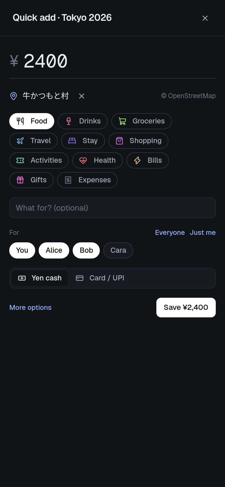
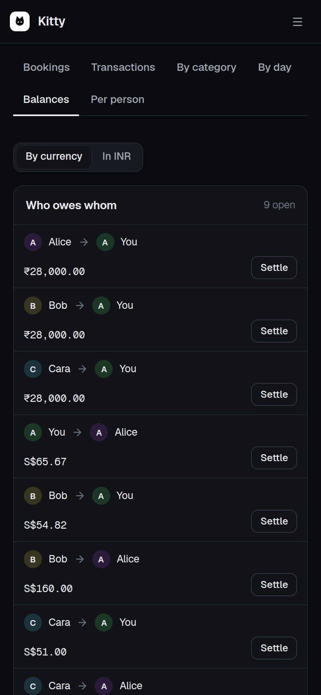
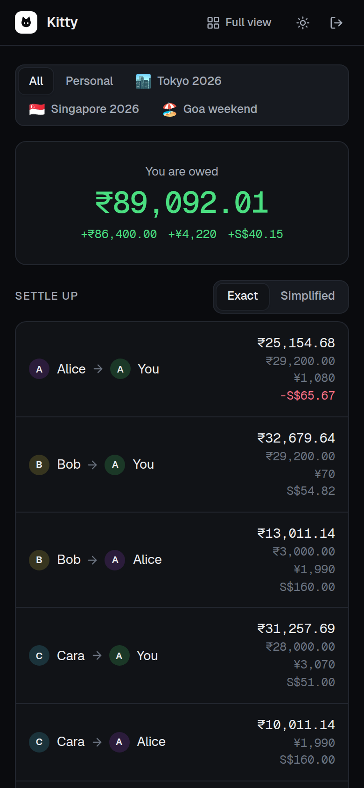

# Kitty

Shared trip expenses for a group of friends, built for the phone and for bad signal. Everyone sees who paid, who owes whom and what is booked, in the currency it was spent in, and the trip still opens with no internet.

<p>
  
  
  
  
</p>

## What it does

- **Splits that match real life.** Equal, by amount, or by items with tax and tip shared in proportion. Multi-currency trips keep each expense in its own currency, card spends carry the real rupee charge from the statement, and cash is valued at the trip's exchange rate.
- **Settling up without surprises.** Exact pairwise balances by default; a simplified plan that only forwards a debt along chains that really exist, so nobody is told to pay someone they never dealt with. Exchange-rate crumbs under a set amount can be called square.
- **Fast on a trip.** Quick add is the amount and a few taps: the place comes from your location (OpenStreetMap), the category is guessed, cash or card, and who it was for. Entries made offline queue on the phone and sync later. An iPhone Shortcut can log Apple Pay taps automatically.
- **Bookings in one place.** Flights, hotels, tickets and transfers per trip, with *Next up*, a full-screen address card to show a taxi driver, full-screen tickets for the gate scanner and an emergency card. Readable offline once opened.
- **Sharing without accounts.** View-only links per trip or per person, and family links that show the bookings and nothing about money.
- **Private documents.** A vault for passports and visas, encrypted in the browser (AES-256-GCM, keys derived from the password); share links carry the folder key in the URL fragment, so the server never sees it.
- **Free to run.** Vercel, Turso and Cloudflare R2 free plans. Uploads stop at 95% of each storage limit.

## How it is built

| Part | How |
|---|---|
| App | React 19 and Vite, a PWA with a service worker; plain CSS with design tokens, light and dark |
| API | Node 24 running TypeScript directly, no framework; one serverless function on Vercel |
| Data | libSQL: Turso in production, a SQLite file locally; numbered migrations |
| Files | Receipts and booking photos in the database; documents in Cloudflare R2 through signed URLs |
| Money | Integer minor units everywhere; the balance engine is pure TypeScript with its own tests |
| Notifications | Web Push with VAPID |

`yarn test` runs 40 tests on the engine and the API.

## Run it locally

```sh
yarn install
cp .env.example .env   # owner name, email and password for the first sign-in
yarn seed              # optional: sample trips with Alice, Bob and Cara
yarn dev               # API and app together
```

Without `TURSO_DATABASE_URL` the data lives in `data/ledger.db`.
